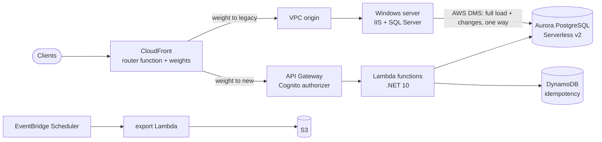

# PurchaseDesk migration assessment

**Prepared:** 2026-11-21 · **System:** PurchaseDesk, frozen at tag [`legacy-v1`](https://github.com/sunnypatel2048/purchasedesk-to-serverless/tree/legacy-v1)
· **Target:** AWS Lambda, Amazon API Gateway, Amazon Aurora PostgreSQL

## 1. Summary and recommendation

PurchaseDesk is a small internal purchase-order API on one Windows server: ASP.NET Web API 2 on .NET Framework 4.8
in IIS, SQL Server 2019 on the same machine, its business rules in seven stored procedures, and a nightly export
written to the server's own disk.

**Recommendation: refactor the application to Lambda and replatform the data to Aurora PostgreSQL, in stages,
without a big-bang cutover.** Replicate the data with AWS DMS, prove the new read path equivalent against recorded
legacy responses, move reads route by route by percentage, then cut writes over once during a short, measured
freeze. Retire the Windows server last.

| | Outcome expected |
|---|---|
| User impact | Reads never go down; writes pause once, for about 2 minutes |
| Reversibility | Every step before the write switch is undone in about 90 seconds |
| Licensing | No Windows Server or SQL Server licence after decommissioning |
| Running cost | Near zero when idle (Lambda, API Gateway, Aurora that pauses itself) |
| Main risk | Behaviour drifting during the rewrite of T-SQL rules into C#: controlled by 40 recorded golden responses |

## 2. Current state

| Component | Today | Size |
|---|---|---|
| API | ASP.NET Web API 2, .NET Framework 4.8, IIS on Windows Server 2022 | 7 routes; about 800 lines of C# |
| Business rules | 7 SQL Server stored procedures, called through ADO.NET (no ORM) | 249 lines of T-SQL |
| Database | SQL Server 2019 Developer, same server, `SQL_Latin1_General_CP1_CI_AS` | 4 tables: 50 suppliers, 2,000 orders, 8,109 lines, 3,482 audit rows |
| Nightly job | .NET Framework console program, Windows Scheduled Task | Writes `D:\Exports\...\approved-orders-yyyyMMdd.csv` |
| Configuration | `Web.config` / `App.config`: connection string, API key, approval limit (25,000) | |
| Identity | One shared API key in a header; the user name is whatever the client sends | |
| Logging | Text files on the server's disk | |
| Health checks | None | |

### Dependencies

- **Clients** call the API with the shared key. They depend on its exact JSON: PascalCase names, four-decimal money,
  dates without a time zone ([golden files](../golden/api)).
- **A downstream consumer** reads the nightly CSV. It depends on the file's bytes: Windows-1252, CRLF, US date and
  number formats ([golden files](../golden/export)). Its owner must be part of any decision to change the format.
- **The server itself**: the Scheduled Task runs on its clock, the export lands on its `D:` drive, the supplier list
  is cached in its memory for 10 minutes.

## 3. Findings and risks

Each finding below is a behaviour the migration must keep or change on purpose. The full engine-level map is in
[sqlserver-to-postgresql.md](sqlserver-to-postgresql.md).

| # | Finding | Risk if missed | Handling |
|---|---|---|---|
| F1 | Business rules live only in T-SQL (rounding, approval limit, status transitions, numbering, audit) and are untested outside the database | Silent behaviour change in the rewrite | Golden files define "equivalent" ([ADR-0009](adr/0009-golden-files-define-equivalent.md)); parity tests compare every route |
| F2 | T-SQL `ROUND` goes half away from zero; C#'s default does not (2.345 gives 2.35 vs 2.34) | Totals off by a cent on 288 seed lines | Explicit `AwayFromZero` in domain code |
| F3 | Uniqueness, search and sort rely on a case-insensitive collation; PostgreSQL is case-sensitive | Duplicate supplier codes; searches that find less; a different supplier order | `lower()` unique index, `ILIKE`, explicit ICU sort |
| F4 | NULLs sort first ascending in SQL Server, last in PostgreSQL | Paging changes order | Explicit `NULLS FIRST/LAST` |
| F5 | DMS copies identity values but not sequence positions | First insert after cutover fails | Sequences advanced inside the cutover script |
| F6 | The API's concurrency token is a SQL Server `rowversion` | Lost updates if dropped | A `version` column with the same optimistic check |
| F7 | Secrets and the approval limit sit in `Web.config`; one shared API key | Credential exposure; no per-user identity | Secrets Manager and Parameter Store; Cognito tokens on new routes |
| F8 | In-memory cache, local disk and local clock tie the app to one server | Breaks with more than one instance | Cache retired; export to S3; schedule in UTC with EventBridge Scheduler |
| F9 | No idempotency: a double submit creates two orders | Duplicate orders under retries | Idempotency key on creation |
| F10 | A line Sku over 40 characters returns 500 | Client sees a server error for bad input | New API returns 400; recorded as a deliberate difference |
| F11 | The CI test server (SQL Server 2019 RTM) and the target build (CU32) behaved differently once | A difference reaching a client unnoticed | Recorded in [ADR-0003](adr/0003-sql-server-2019-cu32-everywhere.md); CI moves to CU32 if one ever does |

## 4. Strategy per component

| Component | Strategy | Reason |
|---|---|---|
| IIS web application | **Refactor** to Lambda (.NET 10, arm64) | Small code base; idle cost to zero ([ADR-0006](adr/0006-lambda-dotnet10-arm64.md)) |
| Stored procedures | **Refactor** into tested C# | Rules in the database cannot follow it to PostgreSQL unchanged and are untestable where they are |
| SQL Server database | **Replatform** to Aurora PostgreSQL Serverless v2 | Keeps the relational model, removes the licence ([ADR-0005](adr/0005-aurora-postgresql-serverless-v2.md)) |
| Scheduled task and local export | **Replace** with EventBridge Scheduler, Lambda and S3 | Nothing may depend on one server's clock or disk |
| In-memory supplier cache | **Retire** | Hid stale data; unnecessary at this size |
| Shared API key | **Replace** with Cognito tokens | Per-user identity and expiry |
| Windows server | **Retire** last | Only after every route and job has a new home |

## 5. Target architecture

During the migration both systems run side by side behind one CloudFront distribution
([ADR-0004](adr/0004-cloudfront-function-front-door.md)). After decommissioning, only the right-hand side remains.

## 6. Sequence and rollback

| Step | What changes | Way back |
|---|---|---|
| 1. Baseline | All traffic to legacy through the front door | Nothing to undo |
| 2. Replicate | DMS loads Aurora and keeps it in sync | Stop the task; legacy untouched |
| 3. Prove parity | New read routes compared with the golden files and with live legacy | Nothing has moved |
| 4. Shift reads | Each read route at 10%, 50%, 100% | Weight back to 0; about 90 seconds to apply everywhere (measured) |
| 5. Cut over writes | Freeze (edge flag and SQL Server read-only), drain, verify, switch, unfreeze | Before the switch: unfreeze. After it: fix forward |
| 6. Decommission | Remove the Windows server, DMS and the legacy origin | Rebuild from the image; data would need restoring |

The honest limit: after the write switch there is no automatic way back, because Aurora then holds writes SQL
Server does not. A production migration would run reverse replication for a bake period.

## 7. Success measures

| Measure | Target |
|---|---|
| Golden-file parity on every read route | 100% after documented normalisations |
| Failed requests while reads shift | 0 |
| Rollback from 50% to 0% | Under 90 seconds |
| Write freeze | Set in Phase 8; about 2 minutes expected |
| Data at cutover | Row counts and per-table checksums match; DMS validation clean |
| Cost | Recorded for a legacy-only hour and a serverless-only hour |

Measured values go into [measurements.md](measurements.md) on the day they are taken.

## 8. Cost

| | Legacy (per hour, us-east-1 list, 2026-11-21) | Serverless after decommission |
|---|---|---|
| Compute | Windows `t3.medium` with licence: $0.060 | Lambda: per request, near zero at this volume |
| Database | SQL Server on the same instance; 60 GB gp3 disk about $0.007 | Aurora Serverless v2: $0.12 per capacity-unit hour while awake, storage only when paused |
| Total | about $0.07 per hour, all day | about $0.06 per hour while busy; storage only when idle |

During the migration both run, plus DMS ($0.037/h) and interface endpoints: about $0.20 per hour. Measured costs
replace these estimates once Cost Explorer has them.

## 9. AWS Transform: what it would and would not do here

AWS Transform has agents for .NET and full-stack Windows modernization. Read on 2026-11-21:

- Its **SQL Server** path converts schema and T-SQL stored procedures to PL/pgSQL on Aurora PostgreSQL 15+ and
  rewrites ADO.NET and Entity Framework data access for Npgsql. SQL Server 2008 R2 to 2022 are supported sources.
  It does **not** accept .NET Framework 4.x: "you must first upgrade to .NET Core 6+ using AWS Transform for .NET
  modernization before using SQL Server transformation capabilities" ([user guide][t-sql]).
- Its **.NET** path ports .NET Framework applications to cross-platform .NET 8 or 10 on Linux, from a repository
  connection or an uploaded zip ([FAQ][t-faq]). Transformed applications get deployment configurations for
  **Amazon EC2 Linux and Amazon ECS** ([product page][t-win]); Lambda is not mentioned.

So for PurchaseDesk it would deliver a containerised .NET app with its business rules still in the database, as
PL/pgSQL. This assessment recommends moving the rules into tested C# on Lambda instead (F1, section 4), which is
the opposite choice on the point that matters most. AWS Transform is the stronger option for a large estate of
similar applications headed for containers.

**Recommendation for Phase 5:** a time-boxed trial (two hours) of its assessment on the frozen code and schema, to
compare its findings with this document. Open before trying: the price of the service and the setup it needs;
whether it handles Web API 2 projects specifically (the readable pages list "web APIs" without detail).

[t-sql]: https://docs.aws.amazon.com/transform/latest/userguide/sql-server-modernization.html
[t-faq]: https://aws.amazon.com/transform/faq/
[t-win]: https://aws.amazon.com/transform/windows/

## 10. Open questions and assumptions

- **Export consumer:** whether it can accept UTF-8 and ISO dates. Until answered, the new export reproduces the
  legacy bytes.
- **JSON shape changes:** each deliberate difference (date-only format, 400 for over-long input, idempotency) needs
  client sign-off in a real engagement; here they are listed and justified.
- **Time zone:** the legacy server runs on UTC; all stored times are treated as UTC.
- **Scale:** the data volume is a demo size. A ten-times larger database changes DMS instance size and the full-load
  time, not the approach.
